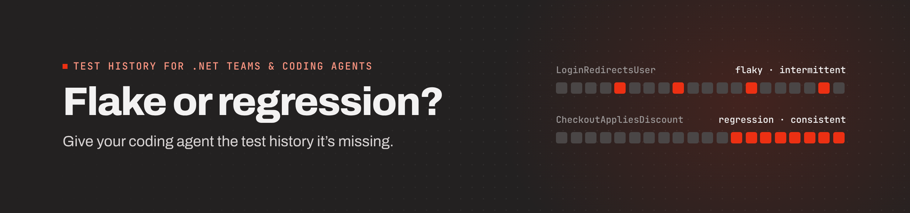

# Xping

**Give your coding agent the test history it's missing.**

Coding agents see one failing run and make the test pass: they loosen the assertion, add a retry, bump a timeout. With one data point, a flaky test and a real regression look the same.

Xping records every `dotnet test` run, including local runs that never reach CI. Pooled across your team, that history becomes a per-test confidence score with the evidence behind it, so your agent and your team can tell a flake from a real failure before anyone edits the test.

## How it works

1. **Record.** The SDK captures every test execution on laptops and in CI, with no changes to your tests.
2. **Score.** Each test gets a confidence score, a reliability tier and an evidence level that says how much history stands behind the number.
3. **Answer.** Ask from the terminal with `xping report`, read it in the portal, see it on GitHub pull requests, or let your agent ask before it touches a failing test.

## Try it locally (free, no account)

```bash
dotnet add package Xping.Sdk.XUnit   # or Xping.Sdk.NUnit / Xping.Sdk.MSTest
dotnet tool install -g Xping.Cli
dotnet test
xping report
```

Local mode shows run-by-run history, inconsistent and newly failing tests, and consistent failures from your own machine. See the [local-first quickstart](https://docs.xping.io/getting-started/local-first.html).

## Xping Cloud: invite-only pilot

Confidence scores need history from more than one machine. Xping Cloud pools runs from your team, branches and CI, and adds per-test scoring, root-cause categorisation and GitHub pull-request insights.

We're onboarding a small number of .NET teams for a 3-week pilot. **[Apply for the pilot →](https://xping.io/contact?pilot=True&utm_source=github&utm_medium=org_profile)**

## Repositories

- **[sdk-dotnet](https://github.com/xping-dev/sdk-dotnet)**: .NET SDK for NUnit, xUnit and MSTest (MIT)

## Resources

- **Website:** [xping.io](https://xping.io)
- **Documentation:** [docs.xping.io](https://docs.xping.io)
- **Support:** [open an issue](https://github.com/xping-dev/sdk-dotnet/issues)
